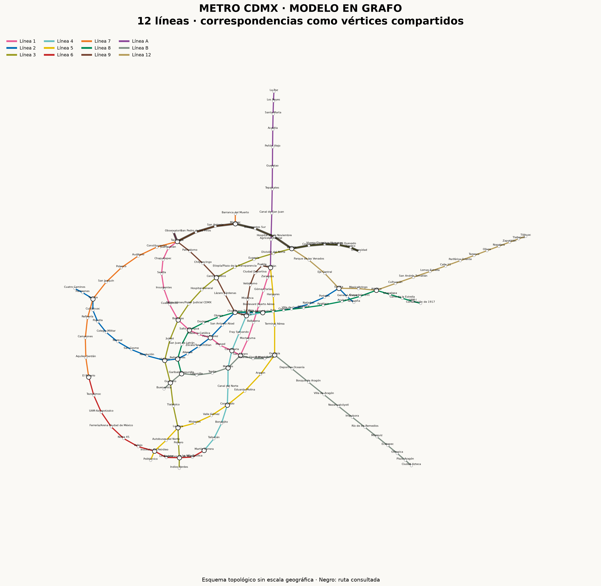

# LOGICA — Grafo del Metro de la CDMX

Proyecto de Lógica Matemática y Matemáticas Discretas. Modela las 12 líneas del Metro de la Ciudad de México mediante un grafo en Python con **NetworkX** y lo visualiza con **Matplotlib**.

## Modelo matemático

Se utiliza un grafo simple, no dirigido y con costo unitario **G = (V, E)**:

- **Vértices:** estaciones. Una estación de correspondencia se representa con un solo vértice compartido por sus líneas.
- **Aristas:** conexiones entre estaciones consecutivas de una línea. Se puede recorrer cada conexión en ambos sentidos.
- **Atributos:** cada vértice almacena sus líneas y cada arista la línea correspondiente y un peso de 1.
- **Camino mínimo:** minimiza la cantidad de tramos entre estaciones mediante búsqueda en anchura (BFS), con complejidad O(|V| + |E|).

Las 195 estaciones contadas por línea se reducen a **163 vértices únicos** al unificar correspondencias. El modelo contiene **183 aristas**. Los transbordos se cuentan cuando cambia la línea entre dos tramos consecutivos; no añaden aristas ni costo. La ruta obtenida minimiza tramos, no tiempo de viaje ni cantidad de transbordos. Si existen varios caminos mínimos, se devuelve uno.

Se modela la red estructural completa, sin cierres temporales ni ampliaciones en construcción. El dibujo es topológico y no representa distancias geográficas.

## Ejecución

Requiere Python 3.11 o posterior.

```bash
git clone https://github.com/armani-av/LOGICA.git
cd LOGICA
python -m venv .venv
```

Activar el entorno en Windows (PowerShell):

```powershell
.venv\Scripts\Activate.ps1
```

En macOS o Linux:

```bash
source .venv/bin/activate
```

Instalar dependencias y ejecutar:

```bash
python -m pip install -r requirements.txt
python metro.py
```

Consultar otra ruta o listar las estaciones:

```bash
python metro.py --origen "Ciudad Azteca" --destino "Tláhuac"
python metro.py --estaciones
```

Los nombres aceptan diferencias de mayúsculas y acentos. Para nombres compuestos se utiliza el nombre completo mostrado por `--estaciones`.

## Resultados

El programa muestra el número de vértices, aristas, correspondencias, componentes conexas, grado promedio, diámetro y estaciones de mayor grado. También imprime el camino mínimo, las líneas utilizadas y los transbordos.

Por defecto calcula **Observatorio → Universidad**: 12 tramos y 13 estaciones visitadas. El camino generado pasa por Tacubaya, Mixcoac y Zapata, con 3 transbordos.

Genera en `resultados/`:

| Archivo | Contenido |
| --- | --- |
| `red_metro.png` | Grafo por colores de línea, con la ruta resaltada en negro. |
| `analisis.txt` | Propiedades del grafo y detalle de la ruta. |
| `red_metro.graphml` | Grafo exportado para abrirlo en NetworkX o Gephi. |



## Archivos del proyecto

| Archivo | Función |
| --- | --- |
| `datos.py` | Listas ordenadas de estaciones de las 12 líneas y sus colores. |
| `metro.py` | Construcción, análisis, búsqueda de rutas, dibujo y exportación. |
| `test_metro.py` | Verificación de estructura, correspondencias y rutas. |
| `requirements.txt` | Dependencias utilizadas. |

## Verificación

```bash
python -m unittest -v
```

Comprueba los conteos de la red, su conectividad, la ausencia de lazos, las correspondencias de Pantitlán y Chabacano, una ruta entre líneas, el recorrido inverso, el caso de origen y destino iguales y el rechazo de estaciones inexistentes.

## Conclusión

La representación como grafo permite estudiar la conectividad de la red y encontrar recorridos mínimos. Al compartir vértices en las correspondencias, las distintas líneas forman una sola componente conexa. El grado de una estación expresa sus conexiones inmediatas, mientras que el diámetro mide la mayor distancia mínima entre dos estaciones en número de tramos.

## Fuentes

- [STC Metro: red y recorridos por línea](https://www.metro.cdmx.gob.mx/la-red).
- [STC Metro: cifras de operación](https://www.metro.cdmx.gob.mx/operacion/cifras-de-operacion).
- [NetworkX: shortest_path](https://networkx.org/documentation/stable/reference/algorithms/generated/networkx.algorithms.shortest_paths.generic.shortest_path.html).

Consulta: 27 de octubre de 2026.
